# Hingegate

A prank for Android foldables. Every so often when you unfold the phone, Hingegate makes the inner screen look
like its hinge just failed: a black ink blot on the crease, a bright multi-coloured line running from it to the
edge of the screen, and a thin line running down the fold. Fold the phone and it is gone again.

It was inspired by photos of a certain new foldable whose inner screens all seem to crack the same way at the
hinge.

## Screenshots

Taken on the Pixel Fold emulator. Every crack is different.

### The crack

<table>
  <tr>
    <td>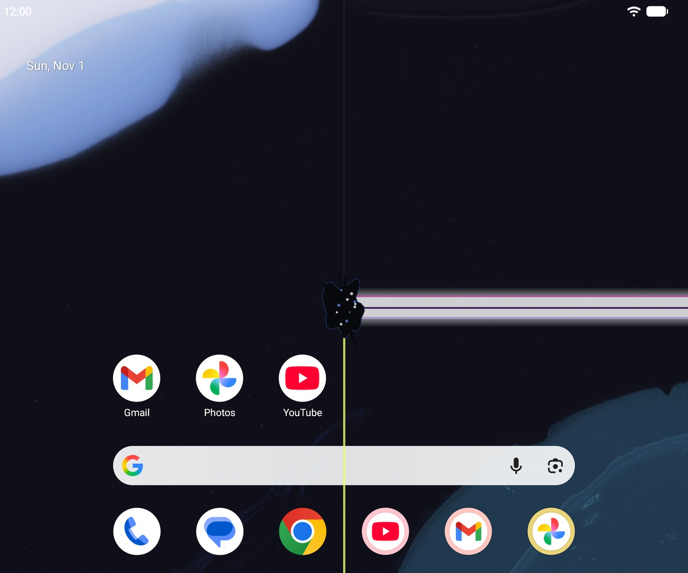</td>
    <td>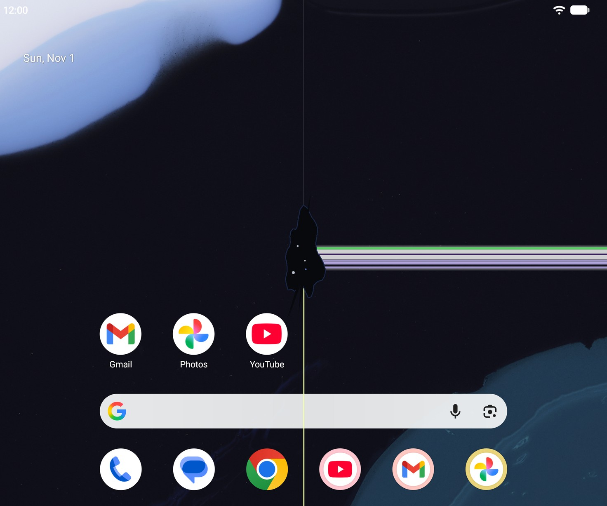</td>
  </tr>
  <tr>
    <td>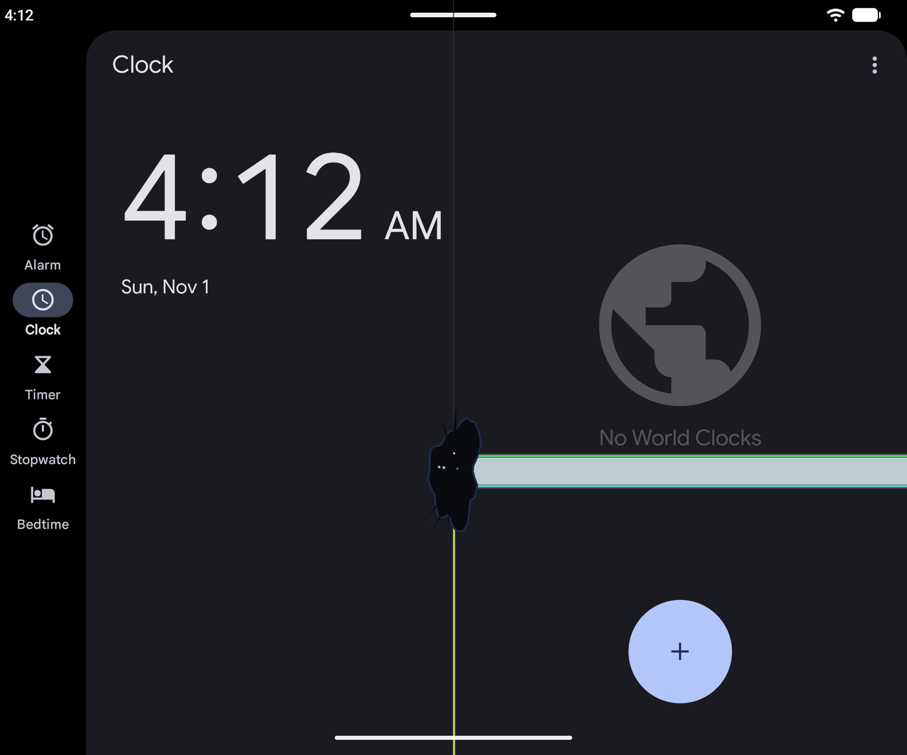</td>
    <td>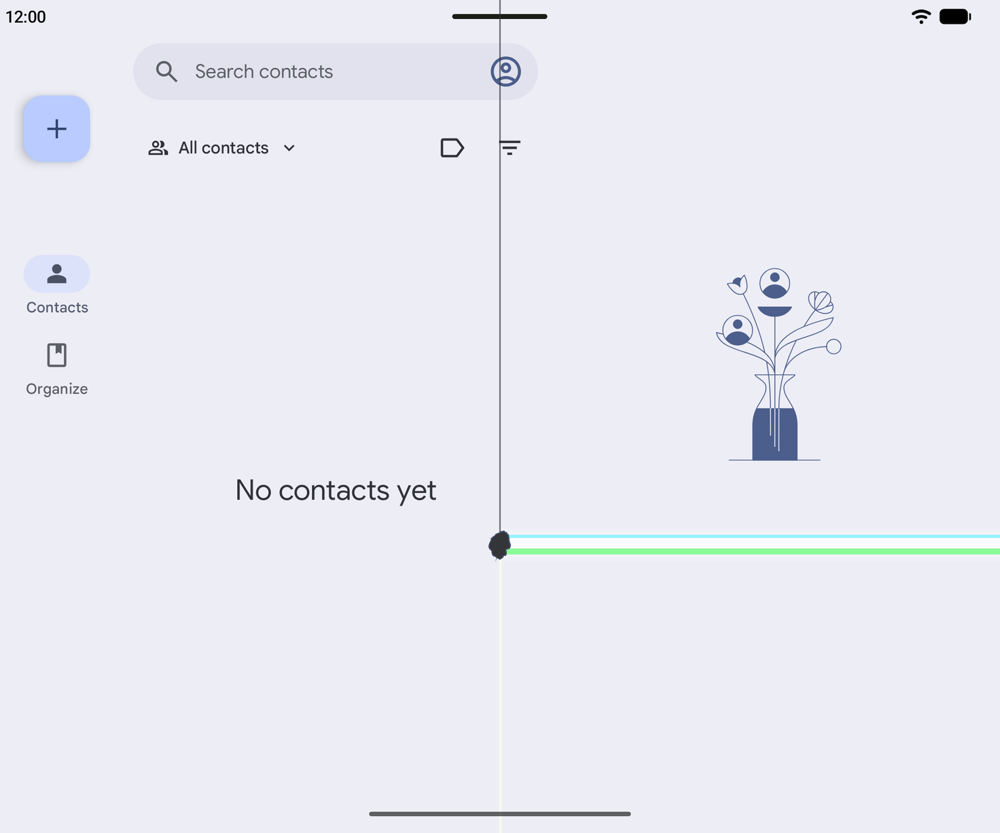</td>
  </tr>
  <tr>
    <td colspan="2" align="center">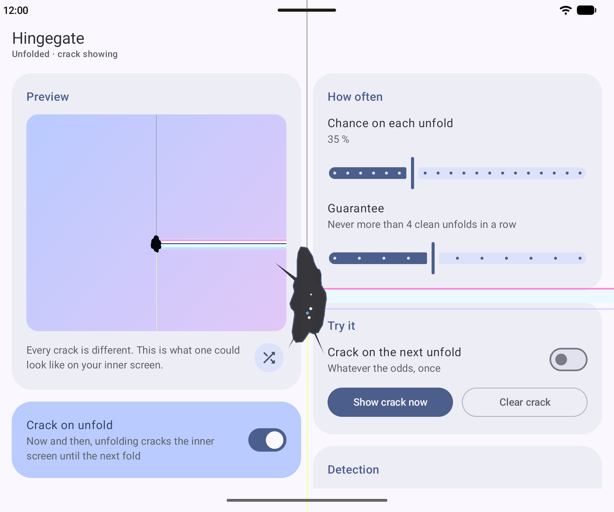</td>
  </tr>
</table>

### The app, unfolded

<table>
  <tr>
    <td>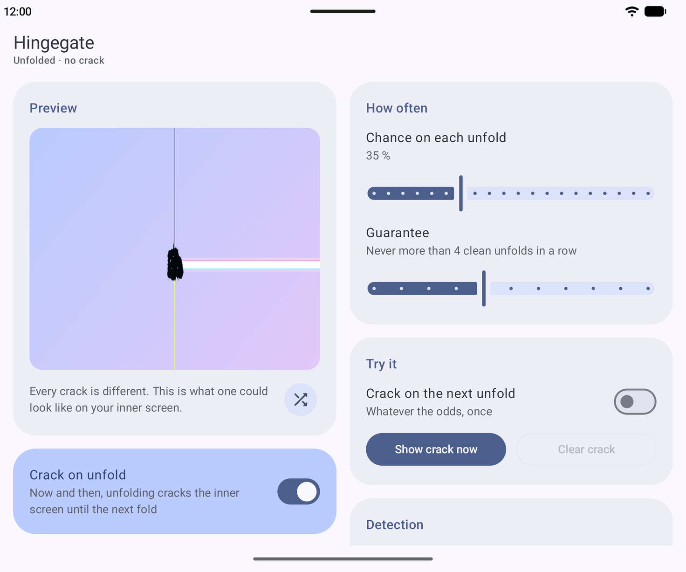</td>
    <td>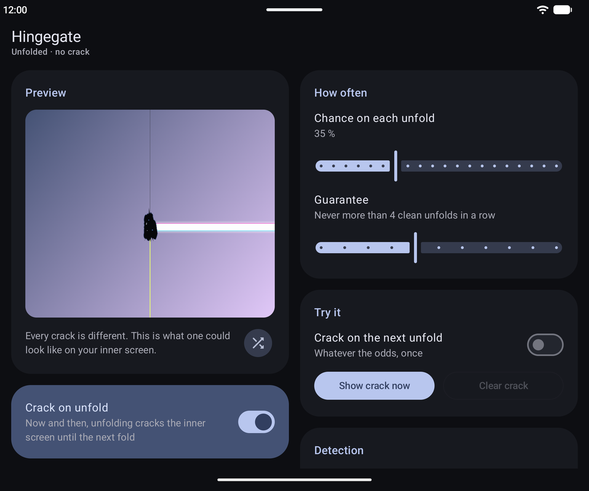</td>
  </tr>
</table>

### The app, on the cover screen

<table>
  <tr>
    <td>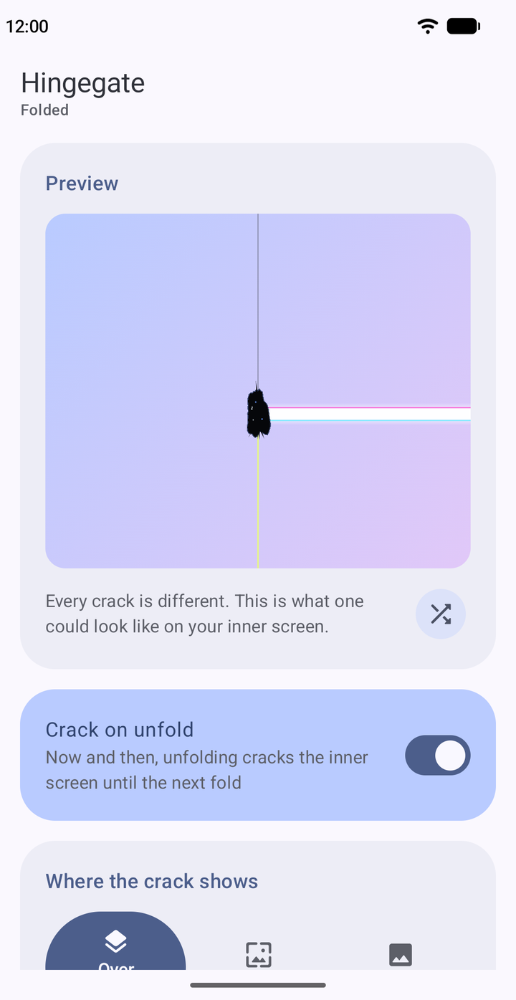</td>
    <td>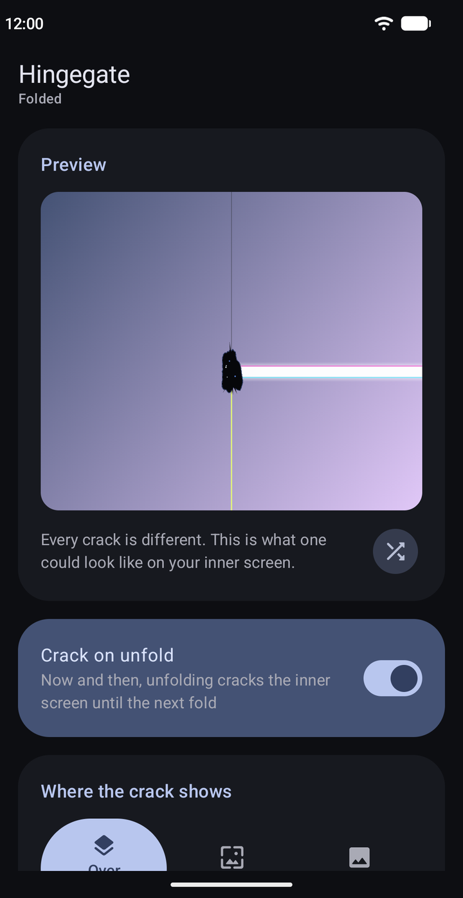</td>
    <td>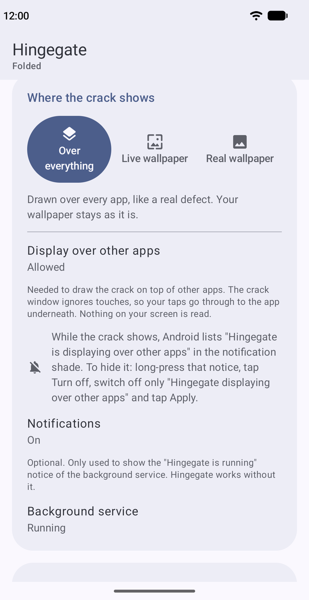</td>
    <td>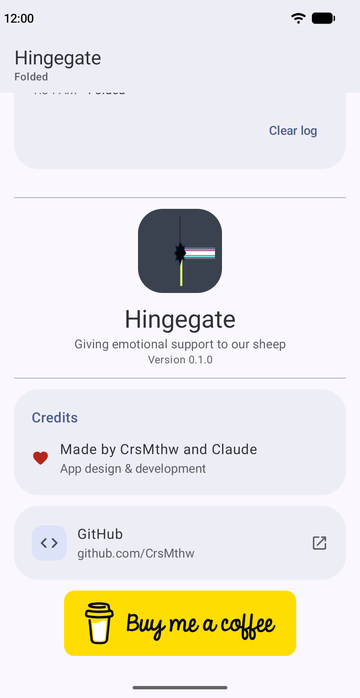</td>
  </tr>
</table>

## Three ways to show the crack

- **Over everything**: the crack is drawn over every app, like a real display defect. Your wallpaper stays as it
  is. Needs the "Display over other apps" permission and runs a small foreground service.
- **Live wallpaper**: Hingegate becomes your live wallpaper (you pick an image for the main screen and one for the
  cover screen) and the crack is drawn on the wallpaper only.
- **Real wallpaper**: your own still wallpaper stays, and on a cracked unfold the inner screen's home wallpaper is
  swapped for a copy of it with the crack drawn in; the clean copy goes back afterwards. Android only lets an app
  read the current wallpaper with "All files access", so this mode asks for it (it is used for nothing else, and
  the app has no internet access). It runs the same small foreground service. The crack is drawn for the way the
  phone opens, so it does not follow screen rotation. On Samsung foldables only the inner screen's home wallpaper
  changes; on foldables with one wallpaper for both screens, the cover screen shows the copy too. The lock screen
  is not touched.

Every permission is explained before Hingegate asks for it.

You choose how often it happens: a chance per unfold, and an optional "never more than N clean unfolds in a row".

## Works on

Any foldable on Android 12 or later. The hinge position comes from Android's window manager where the phone
reports it, and is estimated from the screen shapes where it does not.

## Changelog

See [CHANGELOG.md](CHANGELOG.md).
